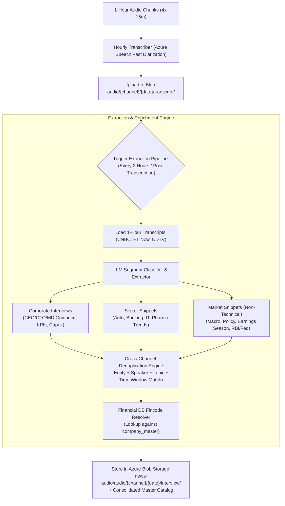

Here is the complete architectural plan for the **Interview, Sector & Market Snippet Extraction Pipeline** that triggers directly after the transcription workflow.

---

### 🏛️ End-to-End Pipeline Workflow



---

### 1. Extraction Categories

The LLM extraction engine will parse the raw transcripts into three distinct content streams:

1. **Corporate Interviews**:
   - **Target**: Company management discussions (CEO, MD, CFO, Promoter).
   - **Extracted Fields**: Company Name, Executive Name, Designation, Quarter Discussed, Revenue/Margin Guidance, Capex Plans, Demand Trends, Key Verbatim Quotes.
2. **Sector Snippets**:
   - **Target**: Sectoral roundups, industry shifts, regulatory policy impacts (e.g., Cement volume trends, Auto festive inventory, Banking credit growth, Real Estate pre-sales).
   - **Extracted Fields**: Sector Name, Sub-segments, Key Insights, Analyst/Expert Name, Referenced Companies.
3. **Market Snippets (Non-Technical Only)**:
   - **Target**: High-level macroeconomics, monetary policy, currency/crude movements, budget/fiscal updates, earnings season macro commentary.
   - **Strict Negative Filter**: Filters out technical day-trading noise (e.g., moving averages, RSI, candlestick chart patterns, support/resistance levels, option strike calls).

---

### 2. Cross-Channel Deduplication

Because major management interviews and press briefings often air across multiple channels (e.g., simultaneous broadcast on CNBC and ET Now):
- **Matching Criteria**:
  1. `company_name` (canonicalized)
  2. `speaker_name` and designation
  3. `time_proximity` (interviews occurring within a ±30–60 minute window)
  4. High semantic overlap in key announcements/guidance.
- **Resolution**:
  - The highest audio/transcript quality instance is selected as the **Primary**.
  - Secondary broadcasts are linked in metadata (e.g., `"broadcast_channels": ["cnbc", "etnow"]`).
  - Exactly **1 unified record** is generated to prevent duplicate downstream alerts.

---

### 3. Database Fincode Resolution (`company_master`)

Using our read-only access to Azure PostgreSQL (`financial_db`), each extracted company is automatically resolved against `company_master`:
- **Query Strategy**:
  1. Exact match on `symbol` (NSE/BSE ticker).
  2. Substring / case-insensitive match on `compname` and `s_name` (e.g., `"Aye Finance"` or `"Tata Motors"`).
  3. Filter active listings: `(nse_sublisting = 'Active' OR bse_sublisting = 'Active')`.
- **Enriched Metadata**:
  - `fincode` (e.g., `100570`)
  - `symbol` (e.g., `TMPV`)
  - `compname` (e.g., `Tata Motors Passenger Vehicles Ltd.`)
  - `industry` (e.g., `Automobiles - 4 Wheelers`)

---

### 4. Azure Blob Storage Structure

As requested, all extracted data will be saved directly into the **`news-audio`** container under an **`interview/`** subfolder:

```text
news-audio/
└── audio/
    ├── cnbc/
    │   └── 2026-11-23/
    │       ├── transcript/
    │       │   ├── 0400_0500_transcript.json
    │       │   └── 0400_0500_transcript.md
    │       └── interview/                                <--- Channel-specific
    │           ├── 0400_0500_interviews.json
    │           └── 0400_0500_interviews.md
    │
    ├── etnow/
    │   └── 2026-11-23/
    │       └── interview/
    │           └── 0400_0500_interviews.json
    │
    └── consolidated/                                      <--- Cross-channel deduplicated
        └── 2026-11-23/
            ├── 0400_0600_master_interviews.json           (Deduplicated 2-hr batch)
            ├── 0400_0600_sector_snippets.json
            └── 0400_0600_market_snippets.json
```

---
